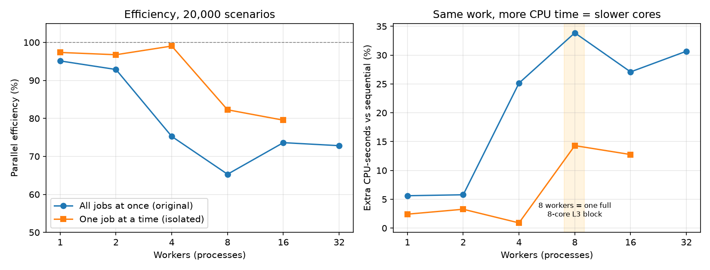

# Profiling and open performance questions

Owner: Enrique Lopez. Experiments run on the course cluster on 18 Nov 2026
(Slurm jobs 32308–32314). Raw data, logs and scripts are in
`results/profiling/`, `jobs/` and `analysis/`.

The progress review (17 Nov) left two open questions about the first
strong-scaling runs (jobs 29828–29834, 20,000 scenarios × 500 properties):

1. Why did the process pool with **one worker** take 140 s while the
   sequential version took 133 s (5% slower)?
2. Why did efficiency **fall at 4–8 workers** (75%, 65%) and **recover at 16**
   (74%)?

## Short answers

1. **The pool itself costs about 10 ms, not 7 s.** Run back to back in the
   same job, pool(1) is only 1.6% slower than sequential (median of 5 pairs),
   within run-to-run noise. Most of the original 5% gap came from the two
   versions running as separate, concurrent jobs on different cores.
2. **The dip was caused by our own jobs running at the same time.** Run one at
   a time, 4 workers reach **99%** efficiency instead of 75%. The original
   jobs used 25–34% more CPU-seconds for the same work: each core computed
   more slowly. A smaller, real loss remains at 8 and 16 workers (about 80%),
   which coincides with filling a whole 8-core L3 cache block.



## How we measured

| What | How | Output |
|---|---|---|
| Node hardware | `scontrol show node haskell`, `lscpu -p` in a batch job | `haskell_topology.txt` |
| Where the original jobs ran and when | `sacct` (Start, End, NodeList, AllocCPUS, TotalCPU) | `sacct_original.txt` |
| Sequential vs pool(1), same cores | one job alternating sequential / pool(1) five times (`jobs/profile_pool1.sh`) | `abab_32308.csv` |
| Where the time goes, per pool phase | cProfile inside the worker process + wall-clock time of every pool phase (`analysis/profile_versions.py`) | `profile_32308.txt` |
| Scaling without interference | sequential and pool 1–16 workers as a chain of jobs that run strictly one at a time (`--dependency=singleton`, `jobs/submit_isolated.sh`), all on `haskell` | `isolated_*.csv`, `sacct_rerun.txt` |
| CPUs given to each job | `taskset -cp` at job start | `iso-*.log`, `profile-pool1-32308.log` |

Tables are produced by `analysis/open_questions.py` (saved in
`analysis_output.txt`); the figure by `analysis/plot_profiling.py`.

**Node `haskell`:** 2 sockets × 128 cores, 2 hardware threads per core
(512 Slurm CPUs). Every 8 consecutive cores share one L3 cache
(`haskell_topology.txt`, last column). Slurm gives each job whole physical
cores: a 2-CPU job received CPUs `8,264`, i.e. core 8 and its own hyperthread,
so one worker per 2 CPUs never shares a core with another worker.

## Question 1: one worker vs sequential

**The pool phases are negligible.** cProfile run inside the worker process
(2,000 scenarios, `profile_32308.txt`):

| Phase | Time |
|---|---|
| Create pool (fork 1 worker) | 7.1 ms |
| First answer from worker | 0.6 ms |
| Send task + return results | 0.9 ms |
| Shut down | 1.2 ms |
| **Total pool overhead** | **9.8 ms (0.08% of the run)** |
| Worker compute vs sequential compute | +0.15% |

Both profiles show the same hot spots: `simulate_scenario` (82% of the time,
the monthly Python loop) and `ndarray.tolist()` (8.5%). The worker runs exactly
the same code at the same speed, and produces identical IRRs.

**Same cores, alternating order** (`abab_32308.csv`, node `fortran`,
20,000 scenarios):

| Pair | Sequential (s) | Pool(1) (s) | Difference |
|---|---|---|---|
| 1 | 124.75 | 126.68 | +1.9 s |
| 2 | 124.30 | 124.77 | +0.5 s |
| 3 | 122.93 | 126.10 | +3.2 s |
| 4 | 123.46 | 126.14 | +2.7 s |
| 5 | 125.98 | 125.56 | −0.4 s |
| **Median** | **124.30** | **126.10** | **+1.9 s (+1.6%)** |

In the isolated runs on `haskell` the gap is +2.7% (132.2 s vs 135.8 s), with
both versions on the same core (CPUs 8,264).

**Conclusion.** The measurable cost of the pool is about 10 ms. What remains
is a small difference of 1.5–3% that the phase timings do not explain and that
is of the same size as the spread between repetitions (2%), so we treat it as
noise rather than a pool cost. The original 5% gap (spread 7%) was larger
because sequential and pool(1) ran as two separate jobs at the same time,
alongside five other jobs: they were measured on different cores under
different load.

## Question 2: the efficiency dip at 4–8 workers

**The original jobs ran concurrently.** `sacct_original.txt` shows that the
sequential job and pool 1, 2 and 4 started within one minute of each other
(18:59–19:00) and pool 8 and 16 started as soon as earlier jobs finished. Only
the 32-worker job ran alone (19:11), because it needed all 64 CPUs of the
account.

**Run one at a time, the dip disappears** (median of 5 runs, efficiency =
T_sequential / T_pool / workers):

| Workers | Original: time (s) | Original: efficiency | Isolated: time (s) | Isolated: efficiency |
|---|---|---|---|---|
| 1 | 140.32 | 95% | 135.77 | 97% |
| 2 | 71.86 | 93% | 68.30 | 97% |
| 4 | 44.34 | **75%** | 33.36 | **99%** |
| 8 | 25.55 | **65%** | 20.08 | **82%** |
| 16 | 11.33 | 74% | 10.39 | 80% |
| 32 | 5.73 | 73% | – | – |

Sequential reference: 133.47 s (original), 132.16 s (isolated).

**Why: each core computed more slowly.** Every configuration does the same
work (5 × 20,000 scenarios), so a perfect machine would use the same
CPU-seconds in every job. `sacct` TotalCPU, relative to the sequential job of
the same batch:

| Workers | Original | Isolated |
|---|---|---|
| 1 | +6% | +2% |
| 2 | +6% | +3% |
| 4 | **+25%** | **+1%** |
| 8 | **+34%** | +14% |
| 16 | +27% | +13% |
| 32 | +31% | – |

Efficiency splits into two factors: how much slower each core runs, and how
much of the time the workers are busy. For the original 8-worker job,
1 / 1.34 (slower cores) × 0.89 (busy fraction from sacct) = 0.66, matching
the measured 65%. For 4 workers, 1 / 1.25 × 0.94 = 0.75, again the measured
value. **Most of the dip is slower cores, not idle workers.**

**Interpretation.** The workers do not share data, so slower cores point to
shared hardware: the L3 cache and memory bandwidth of an 8-core block, and the
clock frequency, which drops as more cores in a block are active (`lscpu` at the
start of job 32308 showed the cores of node `fortran` (same size as `haskell`) running at
51% of their 4.1 GHz maximum).
Slurm packs jobs onto neighbouring cores. With several of our jobs running
together, they likely shared L3 blocks, so even the 4-worker job ran on busy
blocks. This last step is an inference: we recorded the CPUs of the isolated
jobs, but not those of the original ones.

**The remaining loss at 8 and 16 workers is real.** Isolated, 4 workers
(cores 8–11, half an L3 block) use only 1% more CPU time, but 8 workers
(cores 8–15, exactly one full block) use 14% more, and 16 workers (two full
blocks) 13% more. This is consistent with a full 8-core block being slower per
core than a half-empty one. The busy fraction also drops (98% at 4 workers,
93% at 8, 88% at 16). Part of that drop is not the pool: sacct's Elapsed time
includes starting Python and loading NumPy five times, which uses one core
while the others wait, and that weighs more in a 10-second run.

## Consequences for the final runs

- **Submit benchmark jobs one at a time** (`--dependency=singleton`, as in
  `jobs/submit_isolated.sh`), otherwise our own jobs slow each other down and
  the scaling curve is wrong.
- **Report the 1.5–3% pool(1) gap as noise**, not as pool overhead; the
  measured overhead is about 10 ms.
- **Expect about 80% efficiency from 8 workers up**, because of shared
  per-block resources. This is a hardware limit, not a bug in the pool.
- **For the NumPy and Numba versions:** 8.5% of the sequential time is
  `ndarray.tolist()`, converting arrays to Python lists inside every scenario.

## Reproduce

```bash
export PATH=/data/software/envs/ospc/bin:$PATH
sbatch --job-name=iso --dependency=singleton jobs/profile_pool1.sh
bash jobs/submit_isolated.sh haskell
# when squeue -u $USER is empty:
sacct -j <job ids> -P --format=JobID,JobName,NodeList,AllocCPUS,Start,End,Elapsed,TotalCPU,State \
    > results/profiling/sacct_rerun.txt
python analysis/open_questions.py --sacct results/profiling/sacct_original.txt results/profiling/sacct_rerun.txt
python analysis/plot_profiling.py
```

## Use of generative AI

Claude (Anthropic) helped draft the profiling scripts and this write-up. The
experiments were run on the cluster, checked and interpreted by Enrique Lopez;
all numbers come from the files in `results/profiling/`.
